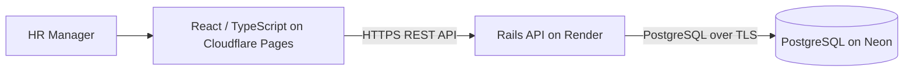

# ACME Salary Management

Built for the **Incubyte Software Engineering Take-Home Assessment**.

ACME's HR team manages compensation across multiple countries in spreadsheets. This application
gives an **HR Manager** a central place to find employee compensation, record immediate base-salary
changes without losing history, and understand how the organization pays its 10,000 employees.
All employee and salary data is synthetic.

## Live demo and important links

| Resource | Link |
|---|---|
| Live Application | [Open ACME Salary Management](https://acme-salary-management-d5z.pages.dev/) |
| Video Demonstration | [Watch the Google Drive demo](https://drive.google.com/file/d/19v3Xznz4GreBV9LxGh-djjXYgThqhBhe/view) |
| GitHub Repository | [vijaypatidar99/acme-salary-management](https://github.com/vijaypatidar99/acme-salary-management) |
| Rails API | [Open the API](https://acme-salary-api-8nch.onrender.com) |

[API health check](https://acme-salary-api-8nch.onrender.com/up).
The backend uses Render's free hosting tier, so the first request after inactivity may take
additional time while the service starts.

Links are owner-provided. Reachability and Google Drive public-sharing permissions could not be
independently verified from the documentation environment.

## Features

### Employee directory

Browse 10,000 employees with server-side pagination; search by name/ID; combine country, department
and status filters; sort; and open profiles. URL-synchronized, debounced search retains focus and
pending drafts. Loading, error and empty states are handled.

### Employee profiles

View identity, country, department, level, status, salary currency/frequency and current or **last-held**
compensation. Complete read-only history shows newest records first, effective intervals, reasons and
FX snapshots. Terminated employees' retained salaries are excluded from active payroll.

### Salary revision management

Enter an immediate revision with amount, currency, monthly/annual frequency and required reason.
Active/on-leave employees are eligible. A demo key authorizes changes; transactional updates preserve
prior salaries, prevent overlaps and reject stale edits. The UI requires review after conflicts and
refreshes compensation, history and related queries after success. Hosted write access requires a
key shared privately by the repository owner.

### Compensation dashboard

View active headcount, annualized USD base-pay totals, mean/median, country/department breakdowns,
group sizes and local-currency totals. Filter by country, department or level; small samples are
flagged. FX rates are fixed illustrations, and comparisons do not establish pay inequity.

### CSV export

Download **all matching rows**, with directory filters and deterministic ordering. Batched export
preserves decimal amounts and UTC microseconds; text sanitization mitigates formula injection
separately from CSV quoting.

## Technology stack

Versions below come from the repository's version file and dependency lockfiles.

| Area | Technologies |
|---|---|
| Backend | Ruby **4.0.9**, Rails API **8.1.4.1**, PostgreSQL |
| Backend quality | RSpec Rails **8.1.0** / RSpec Core **3.13.7**, RuboCop **1.92.2**, Brakeman **8.1.0** |
| Frontend | React **19.3.1**, TypeScript **6.0.3**, Vite **8.3.8** |
| State and styling | TanStack Query **5.107.1**, React Router, Tailwind CSS **4.3.5** |
| Frontend tests | Vitest **5.1.0**, React Testing Library **16.3.3** |
| Hosting | Cloudflare Pages frontend, Render API, Neon PostgreSQL **18** (owner-reported deployment) |
| Development tools | GitHub, GitHub Actions, GitHub Copilot, OpenAI Codex |

GitHub Actions runs the manual seed workflow; the Makefile and `bin/ci` run local application checks.
No automated test CI workflow is included.

## System architecture



- **React:** screens, search/URL state, forms and TanStack Query caching; money display only.
- **Rails:** validation, authorization, revision transactions, FX, analytics and CSV; thin controllers
  delegate to models, services, queries and serializers.
- **PostgreSQL:** employee/history storage, relational/interval constraints, indexes, filtering and
  numeric aggregation.

See the [architecture and entity diagrams](docs/architecture.md) and [API contracts](docs/api-contracts.md).

## Engineering decisions and trade-offs

| Decision | Reason and practical boundary |
|---|---|
| Exact decimal money | `BigDecimal` / PostgreSQL `numeric`; decimal-string APIs. Annualize monthly ×12, convert using the snapshot, round each employee to cents, then aggregate. |
| Preserved history | Close the prior record and insert its successor; half-open periods share one UTC microsecond boundary. |
| Database integrity | FKs, CHECKs, partial uniqueness and GiST exclusions prevent invalid/overlapping periods. Services and verification establish an open record and no gaps. |
| Atomic revisions | Row lock + mandatory current-record token reject stale overwrites; failed writes roll back. |
| Fixed FX snapshots | Reproducible reporting/tests; each salary retains the rate used. |
| Server-side queries | Avoid loading 10,000 rows into React; directory and batched CSV share filtering/ordering. |
| Demo authorization | Shared server key, React memory only, cleared on 401/reload; sent only on revision POSTs. Account management stays outside scope. |
| Complete history | Unpaginated by design; 1,000-record browser fixture checked, with larger-scale limits unverified. |

Detailed rules and rationale are in [domain decisions](docs/domain-decisions.md). Approval status is
tracked separately in the [decision register](docs/architecture-review.md); deployment does not
implicitly close historical approval entries.

## Project structure

```text
backend/
  app/           controllers, models, services, queries and serializers
  db/            migrations, schema and seed entry point
  lib/seeds/     deterministic generator and fictional name pools
  script/        guarded test setup, QA fixtures and Neon seed helper
  spec/          model, service, request, database and safety tests
frontend/
  src/           routes, feature pages, shared components, API client and tests
  script/        native Chrome browser smoke checks
  public/        static assets
.github/         AI instructions/prompts and manual GitHub Actions workflow
docs/            requirements, architecture, decisions, contracts and review evidence
Makefile         local setup and verification commands
```

## Running locally

### Prerequisites

- Git, Ruby **4.0.9** and Bundler **4.1.0**.
- Running PostgreSQL with the `btree_gist` extension available. Local verification used PostgreSQL
  **14.25**; the hosted database is reported as PostgreSQL **18**. These are distinct environments.
- The verified frontend toolchain is Node.js **26.13.1** / npm **12.2.2**.

Start PostgreSQL; your local role needs database-creation and extension privileges. Defaults use a
local Unix socket and OS username. Review `DATABASE_URL` before setup: these commands are for a
local development target, never Neon/shared/user data.

```bash
git clone https://github.com/vijaypatidar99/acme-salary-management.git
cd acme-salary-management
```

### Backend terminal

Start your local PostgreSQL service first. Then, from the repository root:

```bash
cd backend
bundle install
RAILS_ENV=development bin/rails db:prepare
RAILS_ENV=development bin/rails db:seed
# For later local schema updates: RAILS_ENV=development bin/rails db:migrate
read -r -s DEMO_WRITE_KEY
export DEMO_WRITE_KEY
RAILS_ENV=development bin/rails server
```

Enter a local key privately at the `read` prompt. Rails runs at `http://localhost:3000`.
`db:prepare` prepares/migrates and can seed a new database; subsequent seed calls verify valid
existing data without replacing it. Investigate partial data; never add `RESET=1` casually.

### Frontend terminal

In a **separate terminal**, from the repository root:

```bash
cd frontend
npm ci
cp .env.example .env.local        # new checkout only; public API origin, no secrets
npm run dev
```

Open `http://localhost:5173`. The development API defaults to `http://localhost:3000`; change
`VITE_API_BASE_URL` in `.env.local` only if necessary. Enter the backend's locally chosen key on the
revision form. Without a server key, writes correctly return `403 writes_disabled`; reads remain open.

`make setup` is an alternative from the root that installs both apps' dependencies and prepares the
local database. See the detailed [backend](backend/README.md) and [frontend](frontend/README.md) guides.
Rails does **not** automatically load backend `.env` files; export backend values into its shell.

## Environment variables

| Variable | Purpose | Visibility |
|---|---|---|
| `RAILS_ENV` | `development` locally, `test` in the dedicated test terminal, `production` on the host | Configuration |
| `DATABASE_URL` | Overrides Rails database settings; credential-bearing hosted URL stays server-side | **Private** |
| `SECRET_KEY_BASE` | Rails production application secret; distinct from the encrypted-credentials master key | **Private** |
| `DEMO_WRITE_KEY` | Shared demo authorization for salary revision POSTs; unset means writes disabled | **Private**, server-side and entered into the form |
| `RAILS_ALLOWED_HOSTS` | Production Host-header allow-list, e.g. `api.example.com` | Public configuration |
| `CORS_ALLOWED_ORIGINS` | Explicit browser-origin allow-list, e.g. `https://app.example.com`; no wildcard | Public configuration |
| `VITE_API_BASE_URL` | Frontend API origin, e.g. `http://localhost:3000`; embedded in the built bundle | **Public** |

Database passwords, write keys and Rails secrets never belong in `VITE_*`, committed environment
files or URLs displayed to users. Safe examples live in [backend/.env.example](backend/.env.example)
and [frontend/.env.example](frontend/.env.example).

## Database and synthetic seed

A fixed RNG/anchor date and fictional name pools produce varied countries, departments, levels,
currencies and monthly/annual salaries, with contiguous histories and FX snapshots.

| Seed baseline | Locally verified count |
|---|---:|
| Employees | 10,000 |
| Salary records | 16,055: 10,000 open + 6,055 historical |
| Countries / departments | 6 / 9 |
| Currencies / exchange rates | 4 / 4 |

The hosted demo's 10,000 employees are owner-reported; live counts and a successful seed-run record
were not independently verified here. The table describes the local seed baseline.

The [manual Neon workflow](.github/workflows/seed-neon.yml) invokes the existing seed with explicit
confirmation, target/TLS/empty-table checks, concurrency control and integrity verification. See the
[production seed procedure](docs/neon-seeding.md); verify results read-only, without repeatedly seeding.

## Testing and quality assurance

Style follows [`.editorconfig`](.editorconfig), RuboCop Rails Omakase and ESLint.

**Reported latest pre-deployment results: 373 passing RSpec examples and 55 Vitest tests.**
Checked-in [local QA](docs/final-local-qa.md) records the earlier **358/55** run, clean RuboCop, zero
Brakeman warnings, TypeScript/ESLint and build passes. The newer 373-example log was unavailable;
results were not rerun for this documentation update. Production load/security testing is not implied.

Tests cover money/SQL parity, FX, validation, rollback/history constraints, two-connection concurrency,
exact statistics, CSV safety, seed determinism and UI/error workflows. Chrome checked focus, mobile
layout, revisions/stale conflicts on disposable data. The QA report records a 1,002-history response
with four SELECTs and a 49.6ms local median, including its measurement limits.

### Backend checks: dedicated test terminal only

Never run the mutating suite against development or production. From `backend/`:

```bash
bundle exec rspec spec/safety/test_database_safety_spec.rb  # database-free guard checks
ruby script/prepare_test_database.rb                     # NEW attested local test DB
# Source the exact temporary environment file printed by the command above, then:
bundle exec rspec                                        # routine suite
FULL_SEED=1 bundle exec rspec --seed 47214                # includes full seed determinism
bin/rubocop --cache false
bin/rails zeitwerk:check
bundle exec brakeman --no-threads --quiet --no-pager --exit-on-warn --exit-on-error
bundle exec bundler-audit check --no-update               # cached advisory check
```

The generated environment contains the exact disposable target and `ACME_TEST_DATABASE` /
`ACME_TEST_DATABASE_TOKEN` declarations. Keep it outside Git and out of the development server
terminal. Before fixture/schema operations, the guard checks test mode, actual database identity,
locality, ownership and the disposable marker; later connections are checked too.

### Frontend checks

From the repository root:

```bash
VITE_API_BASE_URL=http://localhost:3000 make frontend-check
```

This runs `npm run typecheck`, `npm run lint`, `npm test` and `npm run build` inside `frontend/`.
A runnable production bundle requires the public API origin at build time. The
[browser smoke procedure](docs/local-browser-smoke.md) documents read-only and disposable-write
checks without installing a browser framework. `make backend-check` invokes local `bin/ci`, including
setup and a network advisory scan; use the attested test environment first.

## AI-assisted development

**GitHub Copilot and OpenAI Codex** assisted requirements analysis, architecture planning, Rails and
React implementation, test generation, code review, QA/error investigation and deployment preparation.
The developer retained engineering ownership: scope, exact money, history, concurrency and safeguards
were reviewed against requirements and observed results; approvals remain in the decision register.

Concrete artifacts include the [architecture planning prompt](.github/prompts/architecture-phase.prompt.md)
and [Copilot instructions](.github/copilot-instructions.md). Implementation evidence includes thin
controllers, focused services/queries, shared calculations, typed API hooks and regression tests.

Audits and runtime investigation caught numeric `NaN` acceptance, unsafe test-environment selection,
search-input remounting, Ruby/JavaScript Unicode-length differences and CSV timestamp precision.
Neon's TLS proxy also exposed a verification mistake: server-side `pg_stat_ssl` did not establish
client encryption; the helper now requires `PG::Connection#ssl_in_use?`. Corrections have targeted
tests and review evidence; broader hosted and accessibility verification remains distinct.

## Scope and deliberate exclusions

To focus on accurate base pay, preserved history and compensation questions, the MVP deliberately
excludes onboarding/full employee CRUD, payroll, payslips, tax/statutory deductions, bonuses/equity/
benefits, live FX, bulk imports, full registration/authentication/RBAC and future/retroactive revisions.

## Documentation and engineering artifacts

| Artifact | Purpose |
|---|---|
| [One-page requirements](docs/requirements.md) | Goal, workflows, boundaries and exclusion rationale; committed before application implementation |
| [Domain decisions](docs/domain-decisions.md) | Money, FX, statuses, revision/history and analytics rules |
| [Architecture](docs/architecture.md) / [API contracts](docs/api-contracts.md) | Component/entity diagrams, responsibilities and request/response behavior |
| [Implementation plan](docs/implementation-plan.md) / [decision register](docs/architecture-review.md) | Sequencing, trade-offs and recorded approval status |
| [Assessment validation](docs/assessment-requirement-validation.md) / [earlier audit](docs/final-assessment-audit.md) | Historical compliance findings and remaining work at their review dates |
| [Final local QA](docs/final-local-qa.md) / [browser smoke procedure](docs/local-browser-smoke.md) | Corrections, measured results, safe reproduction and verification limits |
| [Backend review](docs/backend-review.md) / [frontend review](docs/frontend-review.md) | Layer-specific implementation and test evidence |
| [AI instructions](.github/copilot-instructions.md) / [planning prompt](.github/prompts/architecture-phase.prompt.md) | Development guardrails and intentional AI use |
| [Neon seeding](docs/neon-seeding.md) | Manual workflow, required secrets, TLS correction and verification queries |

Older audits predate the deployment links supplied here; their missing-deployment/video findings
are historical, not fresh reachability checks. Decision records retain their own formal approval
status. Broader browser/screen-reader review, hosted load testing and final submission-email delivery
are not established by local test totals.

## Deployment

| Component | Hosting |
|---|---|
| React frontend | Cloudflare Pages |
| Rails REST API | Render |
| PostgreSQL | Neon |

The deployed frontend is configured to call the Rails API, and Render connects to Neon. Production
configuration supplies database credentials, Rails secrets, allowed hosts, CORS origins and write
authorization through server environment settings; only the API origin is a public frontend build
setting. No production load-testing, exhaustive security or uptime guarantee is implied.
