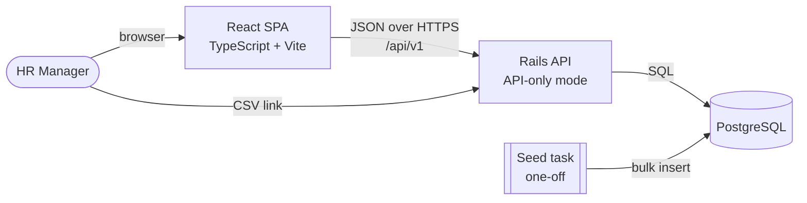
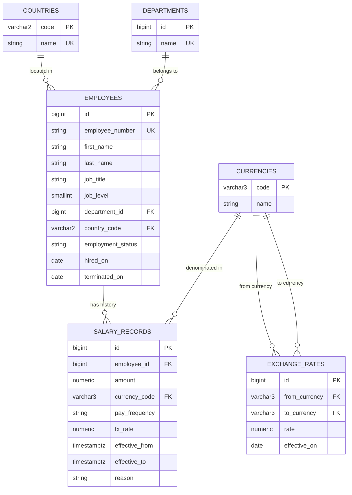
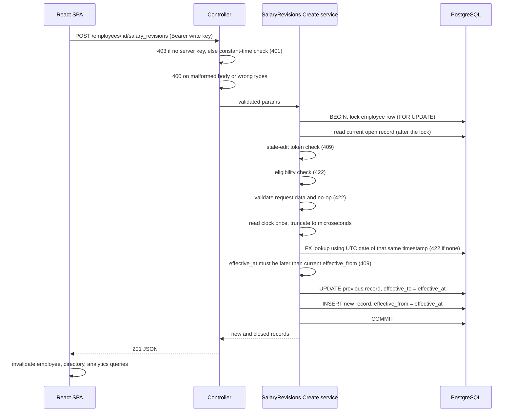
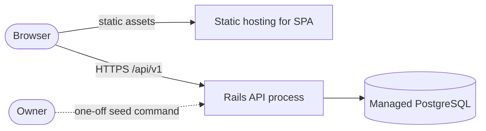

# Architecture

**Precedence:** rank 4 in the hierarchy defined in `architecture-review.md` §1. It implements `requirements.md` and `domain-decisions.md`; where it disagrees with them, they win.
**Status:** Partially approved — **not finalized**. DR-01, DR-03, DR-04, DR-11, DR-20 (design), DR-21 and DR-24 were approved by the owner on 17 November 2026; DR-05, DR-09, DR-12 and DR-14 were decided the same day under the owner's delegated authority and await owner review; the database provider is selected (DR-20: Neon) but its `btree_gist` support is **not yet verified on the hosted database**. These are stated here without tags. Additional low-risk defaults were decided under the current delegation (register §3). Items marked **`[APPROVAL DR-nn]`** are still pending owner decisions tracked only in the register (`architecture-review.md` §3). The application scaffold exists (health route, error handling, CORS, app shell) and was verified; pre-existing backend feature code is also present, but phase completion and contract conformance are not established by this audit (see `audit-report.md`).

## 0. What is an assessment requirement and what is a choice

| Category | Items |
|----------|-------|
| Assessment requirement | 10,000-employee scenario; HR Manager user; backend aligned with role (**Rails preferred**); React or Next UI; a relational database; seed of 10,000 employees; a **one-page requirements document**; deployed, functional software; video demo; meaningful fast deterministic tests; maintainable structure; incremental commits; supporting artifacts including **documented AI-assisted work**; engineering judgment over complexity; submission by committing to Git and replying to the email with the repository link |
| Technology choice (project/owner direction, **not** assessment requirements) | Rails API mode, PostgreSQL, RSpec, React + TypeScript + Vite, Vitest + RTL, TanStack Query, Tailwind, monorepo |
| MVP design decision | Everything else here; pending ones carry `[APPROVAL DR-nn]` |
| Optional enhancement | `reference_data`, `currencies` table, analytics extras (DR-14, DR-16), `rack-attack`, `pg_trgm`, chart library |

Not specified by the assessment: deadline, hosting provider, video duration. The assessment PDF is held by the owner and is not committed.

---

## 1. System context and overview

One persona, one database, one API, one SPA. No queues, caches, search servers or other services.

## 2. Major components and responsibilities

| Component | Responsible for | Not responsible for |
|-----------|-----------------|---------------------|
| **React SPA** | Routing, forms, tables, filter/sort/page state in the URL, display formatting of API strings, calling the API, showing errors, holding the write passphrase in memory | Any money arithmetic, comparison, aggregation, conversion or annualization |
| **Rails controllers** | Parse/validate params, authenticate writes, call one service/query, render JSON/CSV, map errors to the contract | Business rules, SQL building |
| **Models** | Associations, validations, scopes, the Ruby definition of per-record annualization/conversion (`BigDecimal`) | Multi-record workflows |
| **`SalaryRevisions::Create` service** | The revision procedure in `domain-decisions.md` §7 | HTTP concerns |
| **`Employees::Directory` query object** | Filters, search, allow-listed sort, pagination, joins to current salary; **also used by CSV export** | Rendering |
| **`Analytics::Summary` query object** | Aggregate SQL: totals, average, exact numeric median, status counts | Caching |
| **`Compensation` SQL-fragment module** | The single SQL definition of `annual_local` / `annual_reporting` shared by directory, export and analytics | — |
| **Plain-Ruby serializers** | JSON shape (money as strings) | Querying |
| **Seed (`Seeds::DemoDataset`)** | Deterministic generation and post-seed verification, using the same rate-lookup and calculation rules as the application (no formula of its own) | Running in production without explicit override |
| **PostgreSQL** | Source of truth, integrity constraints, aggregation, locks | — |

Formula consistency: the SQL fragment and the Ruby calculation implement the same rules (`domain-decisions.md` §2, §4). **Parity tests** on shared fixtures are mandatory (Phase 4, re-run in Phase 7).

**Backend structure (Rails 8.1 API-only, `backend/`).** Present now: `app/controllers/application_controller.rb` and `app/controllers/concerns/api_error_handling.rb` (the contract's error shape for `400 invalid_request`, `404 not_found` and a generic `500 internal_error`); `config/routes.rb` (framework health route `/up`, a final catch-all that returns the contract's 404 body); `config/initializers/cors.rb` (configured origins only; the local Vite origin by default in development and test); `spec/` (RSpec, spec type inferred from the directory, FactoryBot included). Only `active_model`, `active_record`, `action_controller` and `action_view` are loaded; mail, storage, cable and jobs are not. The current tree also contains `app/controllers/api/v1/`, services, queries, serializers, models, seed logic, migrations, `db/schema.rb` and feature specs from pre-existing work. These span Phases 3–7 and await separate acceptance review; this audit preserves them. The following sections specify intended architecture.

**Frontend structure (`frontend/src/`).** Present now:
- `app/` — `App.tsx` (providers) and `router.tsx` (routes).
- `components/` — `layout/` (page shell), `common/` (shared pieces with app knowledge, e.g. the not-found page), `ui/` (generic primitives, empty until needed).
- `features/` — one folder per workflow: `dashboard/`, `employees/`, `compensation/`, `salary-revisions/` (empty until their phases) and the temporary `health/` page that proves the SPA reaches the API.
- `lib/` — `api.ts` (API base URL from `VITE_API_BASE_URL`; the API client later) and `query-client.ts`.
- `types/` (environment and, later, API types), `styles/` (Tailwind entry and design tokens), `test/` (setup and helpers). Tests sit beside the code they cover.

A feature folder owns its page, components, hooks and API calls; `hooks/`, `utils/` and `constants/` are added only for code genuinely shared across features. TanStack Query is kept for invalidation after a revision (directory, detail and analytics all go stale) and for loading/error state.

## 3. Entity-relationship diagram

The diagram shows the six tables of §4 and their foreign keys (timestamps omitted for brevity). The `EMPLOYEES`–`SALARY_RECORDS` relationship is deliberately drawn as *zero-or-more*: **the database does not guarantee that every employee has a salary record**, let alone exactly one open record. "Exactly one open record per employee" is an application and seed invariant (revision service, seed, verification query); the database only guarantees *at most one* open record and *no overlaps* (§4.7–4.8). `salary_records` has **no FK to `exchange_rates`**: the rate value is copied onto the record (DR-05, approved); `exchange_rates` is only the lookup source at revision/seed time. `currencies` is an optional enhancement that was kept (DR-14, approved); it supplies the foreign-key target for the currency columns.

## 4. Tables

Six tables; each has a use case; rejected candidates are in §10. Natural keys for `countries.code` and `currencies.code` (ISO 3166-1 alpha-2, ISO 4217): stable, no join needed to show a code, and `?country=IN` filters without a lookup. They are stored as `varchar(2)` and `varchar(3)` with explicit length and format CHECKs (DR-21): the `schema.rb` dump turns PostgreSQL `char(n)` into `varchar(n)` (spike, `architecture-review.md` §12), so the design does not depend on `char(n)` semantics. Columns that reference them (`employees.country_code`, `salary_records.currency_code`, `exchange_rates.from_currency`/`to_currency`) use the same `varchar(n)` type and need no CHECK of their own: the foreign key restricts their values.

### 4.1 `countries` — integrity for employee country, filter source, display names

| Column | Type | Null | Constraints | Purpose |
|--------|------|------|-------------|---------|
| `code` | `varchar(2)` | no | PK; CHECK `char_length(code) = 2`; CHECK `code ~ '^[A-Z]+$'` | ISO alpha-2 (DR-21) |
| `name` | `varchar` | no | unique | Display name |

### 4.2 `departments` — filter source and grouping

| Column | Type | Null | Constraints | Purpose |
|--------|------|------|-------------|---------|
| `id` | `bigint` | no | PK | |
| `name` | `varchar` | no | unique | Display name |

Flat list; no hierarchy (not required).

### 4.3 `currencies` (DR-14, approved) — FK integrity for salary and rate currencies

| Column | Type | Null | Constraints | Purpose |
|--------|------|------|-------------|---------|
| `code` | `varchar(3)` | no | PK; CHECK `char_length(code) = 3`; CHECK `code ~ '^[A-Z]+$'` | ISO 4217 (DR-21) |
| `name` | `varchar` | no | | Display name |

Minor-unit exponent is not stored: all seeded currencies are 2-decimal (`domain-decisions.md` §4.1).

### 4.4 `employees` — the directory entity

| Column | Type | Null | Constraints | Purpose |
|--------|------|------|-------------|---------|
| `id` | `bigint` | no | PK | Internal id used in API paths (DR-18) |
| `employee_number` | `varchar` | no | **unique** | Human ID e.g. `ACME-00042`; searchable |
| `first_name` | `varchar` | no | | |
| `last_name` | `varchar` | no | | |
| `job_title` | `varchar` | no | | Display |
| `job_level` | `smallint` | no | CHECK 1–7 | Peer comparison; numeric sort |
| `department_id` | `bigint` | no | FK → departments | |
| `country_code` | `varchar(2)` | no | FK → countries | |
| `employment_status` | `varchar` | no | CHECK in (`active`,`on_leave`,`terminated`) (DR-03) | |
| `hired_on` | `date` | no | | |
| `terminated_on` | `date` | yes | CHECK `(status='terminated') = (terminated_on IS NOT NULL)` and `terminated_on >= hired_on` (DR-09) | |
| `created_at`, `updated_at` | `timestamp` | no | | Rails defaults |

No email/phone/address/DOB: no workflow needs them. Status is `varchar` + CHECK (Rails string enum), not a native enum type.

### 4.5 `salary_records` — append-only salary history

| Column | Type | Null | Constraints | Purpose |
|--------|------|------|-------------|---------|
| `id` | `bigint` | no | PK | |
| `employee_id` | `bigint` | no | FK → employees | |
| `amount` | `numeric(14,2)` | no | CHECK `> 0`. The DR-11 upper bound (`1000000000.00`, entered amount in its own currency and frequency) is enforced in application validation before any write, not by a CHECK; `numeric(14,2)` capacity is the second layer | Local amount per `pay_frequency` period |
| `currency_code` | `varchar(3)` | no | FK → currencies | Original currency |
| `pay_frequency` | `varchar` | no | CHECK in (`monthly`,`annual`) | |
| `fx_rate` | `numeric(18,8)` | no | CHECK `> 0` (DR-05) | Snapshot: 1 unit of `currency_code` in USD at revision time |
| `effective_from` | `timestamptz` | no | UTC, microsecond precision (DR-01) | Inclusive start |
| `effective_to` | `timestamptz` | yes | CHECK `effective_to IS NULL OR effective_to > effective_from` | Exclusive end; NULL = current |
| `reason` | `varchar(255)` | no | CHECK `btrim(reason) <> ''`; trimmed by the application before saving (DR-12) | Why the change was made |
| `created_at`, `updated_at` | `timestamp` | no | | `updated_at` changes only when `effective_to` is set |

Not stored: `annual_local`, `annual_reporting` (derived; a stored copy could disagree with `amount`/`fx_rate`). `fx_rate` is stored because it is an input fact at a point in time, not a derivation. After insertion, a record's salary facts (`amount`, `currency_code`, `pay_frequency`, `fx_rate`, `effective_from`, `reason`) are immutable; the only permitted later change is setting `effective_to` once, when a successor is created. No `created_by`: there are no user identities (see §9).

### 4.6 `exchange_rates` — reference data for rate lookup

| Column | Type | Null | Constraints | Purpose |
|--------|------|------|-------------|---------|
| `id` | `bigint` | no | PK | |
| `from_currency` | `varchar(3)` | no | FK → currencies | Currency being converted |
| `to_currency` | `varchar(3)` | no | FK → currencies | Target (USD in MVP) |
| `rate` | `numeric(18,8)` | no | CHECK `> 0`; CHECK `from_currency <> to_currency OR rate = 1` | 1 `from` = `rate` `to` |
| `effective_on` | `date` | no | | Inclusive start of validity |
| `created_at` | `timestamp` | no | | |
| | | | **unique** `(from_currency, to_currency, effective_on)` | |

Append-only by convention. Safe even if edited because records hold snapshots.

### 4.7 Indexes and constraints

| Index / constraint | Why |
|--------------------|-----|
| `employees (employee_number)` unique | Search/uniqueness |
| `employees (country_code)`, `(department_id)` | Filters and grouping joins |
| `salary_records (employee_id) WHERE effective_to IS NULL` **unique, partial** | Current-salary lookup used by every list/analytics query; blocks a second open record |
| `salary_records` **exclusion constraint**: `EXCLUDE USING gist (employee_id WITH =, tstzrange(effective_from, effective_to, '[)') WITH &&)` | Blocks **all** overlapping ranges, including historical; its gist index also serves per-employee history reads |
| `exchange_rates (from_currency, to_currency, effective_on)` unique | Rate lookup "latest ≤ date" |

Deliberately **not** indexed at 10,000 rows: `employment_status`, name columns, `currency_code`, `job_level`. Add one only after `EXPLAIN ANALYZE` in Phase 10 shows need. `pg_trgm` is the planned fallback for name search and needs approval.

### 4.8 What the constraints guarantee, restated
- The partial unique index prevents only **multiple open-ended records**.
- The exclusion constraint prevents **overlapping historical intervals** (and subsumes the one-open-record rule).
- The exclusion constraint does **not** guarantee that every employee has an open record, nor absence of gaps. The revision service and the seed verification establish those.
- See `domain-decisions.md` §6.2 and §13.

### 4.9 Database capability prerequisites
| Prerequisite | Decision | Needed by |
|--------------|----------|-----------|
| `btree_gist` extension on development, test and the chosen hosted database (or an approved weaker fallback) | **DR-20** — design approved; local spike passed on PostgreSQL 14.25 (`architecture-review.md` §12). Provider **selected: Neon (Free plan)** on documentary evidence (§12.4); **not yet verified on the hosted database** (procedure in §12.5) | Locally satisfied. The hosted check is the remaining G1 blocker for this row unless the owner moves it to a pre-Phase-11 prerequisite (`architecture-review.md` §7.2, U-7) |
| Rails schema dump format must faithfully round-trip the extension, CHECKs, partial unique index and exclusion constraint | **DR-21** — approved: `schema.rb`; `varchar` codes with CHECKs because the dump turns `char(n)` into `varchar(n)` | Decided. Phase 3 re-verifies the `varchar` + CHECK variant and fresh-database setup |

## 5. Responsibility boundaries

- **Database:** identity, referential integrity, range/positivity checks, overlap prevention, row locking, aggregation, sorting, pagination.
- **Backend:** business rules, all money arithmetic/conversion, write authorization, input validation, error mapping, CSV generation.
- **Frontend:** presentation and interaction only. Receives money as decimal strings, formats for display, sends the user's typed amount as a string. Filter/sort/page state lives in the URL so views are shareable and the export link matches the current view.
- **API:** small, versioned `/api/v1`, domain fields rather than table internals. **`api-contracts.md` is the only place error codes are defined**; this document and the tests refer to them by code, never redefine them.
- **Health check:** use the framework-provided health route (outside `/api/v1`, no data); not part of the contract. Verified present on Rails 8.1.4.1 (`GET /up`, Phase 2).

## 6. Data flows

### 6.1 Employee search
1. SPA updates the URL query (`q`, `country`, `department`, `status`, `sort`, `direction`, `page`, `per_page`); TanStack Query calls `GET /employees`.
2. Controller validates and allow-lists params → `Employees::Directory`.
3. One SQL query: `employees` JOIN `countries` JOIN `departments` LEFT JOIN current `salary_records` (partial index), filters, `ORDER BY <allowed field>, id`, `LIMIT/OFFSET`; plus one `COUNT(*)` with the same filters.
4. Serializer emits rows + `meta`. No lazy association loading.

### 6.2 Dashboard analytics
1. `GET /analytics/summary` with optional filters **[APPROVED (delegated) DR-16]**.
2. `Analytics::Summary` runs a fixed number of queries over the active population's current salary. Each computes `annual_reporting` once (subquery/CTE, shared fragment) then `COUNT`, `SUM`, `AVG`, and the **exact numeric median** (`domain-decisions.md` §10.3: ranked rows, middle row or mean of the two middle rows, `numeric` arithmetic, rounding at output), grouped by country / department / organization. Additional queries: per-currency local sums for country rows, and `status_counts` over the filtered employee population (all statuses).
3. **`percentile_cont` is not used**: it coerces `numeric` to `double precision`.
4. Response is assembled with output rounding/stringification only; empty groups follow the contract in `api-contracts.md` §4. Computed per request; no cache without a measured need.

### 6.3 Salary revision

The step order is identical to `domain-decisions.md` §7 (the authoritative text). The clock is read exactly once, after the lock, and that single value serves the FX lookup date, the closure and the insert. The token check is mandatory (**DR-04**, approved); the effective timestamp is DR-01 (approved); eligibility is DR-03 (approved); no-op rejection is DR-10 (approved, delegated).

### 6.4 CSV export
1. SPA renders a plain link to `GET /employees/export.csv` carrying the **same filter, sort and direction** params as the visible directory and **no** `page`/`per_page`.
2. Controller uses the same `Employees::Directory` filter and sort logic (shared code, so list and export cannot diverge), same allow-list, same stable tie-breaker (`id`), default sort `employee_number`, and streams **all** matching rows in batches. No row cap.
3. Money columns use the same SQL expression as the directory. **Text cells are sanitized against spreadsheet formula injection** by the deterministic policy in `api-contracts.md` §5 (applied before RFC 4180 quoting; numeric and date columns are written verbatim). CSV quoting alone does not prevent formula injection.
4. Reads need no secret, so a browser download works without exposing a key to the frontend. The export includes every status unless the `status` filter is supplied.

## 7. Pagination, filtering, sorting, N+1

- **Pagination:** offset/limit. `page` default 1; `per_page` default 25, max 100 (DR-18). **Malformed, zero or negative `page`, and `per_page` outside 1–100 → `400 invalid_parameter`. A page beyond the last page → `200` with empty `data`** and correct `meta`. Keyset rejected: 10,000 rows, random page jumps wanted. No pagination gem.
- **Stable order:** every sort appends `id` as tie-breaker so pages never repeat or skip rows; export uses the same rule.
- **Filtering:** exact-match `country`, `department`, `status`; `q` is a case-insensitive contains-match over first name, last name, "first last" and `employee_number`, with `%`/`_` escaped and bind variables only.
- **Sorting:** allow-list only (`api-contracts.md`); unknown field → 400. Salary sorting uses the SQL `annual_reporting` expression, not local amount.
- **N+1:** directory = one joined query projecting the needed columns; detail = employee + country + department + all salary records in a fixed number of queries. A request-spec query-count helper guards both (Phase 5).
- **Salary history in detail is returned newest first and is unpaginated and unbounded** — an intentional MVP trade-off **[APPROVED (delegated) DR-19]**; no maximum number of revisions is guaranteed and the payload grows with each revision; a paginated history endpoint is the documented follow-up if a long-history fixture measured in Phase 10 shows a problem.

## 8. Deployment topology (high level; no provider is specified by the assessment)

- Default: two deployables + one PostgreSQL. Serving the built SPA from the Rails process (one origin, no CORS) is an alternative **[APPROVAL DR-22]**.
- Cross-origin only: CORS is restricted to an explicit allow-list of configured origins (the SPA origin; never a wildcard), allowing the `Authorization` header in preflight. `rack-cors` is installed and approved for local development (DR-24); the production CORS policy and whether the gem stays are part of **DR-22**. The SPA's API base URL is a build-time, non-secret value.
- Secrets (database URL, Rails master key, write passphrase) are server-side environment variables only.
- **Database (DR-20): Neon, Free plan, PostgreSQL 17 (or 18), direct (non-pooled) connection.** Selected on documentary evidence only; `btree_gist` and the exclusion constraint are **not yet verified on Neon** (`architecture-review.md` §12.4–12.5). The connection string is an environment variable (never committed); the pooled endpoint is not used to keep one connection configuration and support migration session semantics; transaction-scoped row locks alone do not rule out transaction pooling. Neon's free compute suspends after 5 minutes idle, so the first request after idle may be slow (unmeasured). Neon hosts only the database: the application host and production CORS are DR-22.
- Host requirements: PostgreSQL with `btree_gist` (**DR-20**: design approved, verified locally on 14.25, **not yet verified on Neon**), HTTPS, ability to run a one-off seed command (from the owner's machine against the direct connection string, or from the application host).
- Production-demo verification (Phase 11): exactly 10,000 employees, invariant queries pass, write protection active, no secrets in the bundle or logs.

## 9. Security and demo-data considerations

### 9.1 Scope
Full authentication, RBAC, SSO, registration and password recovery are outside the brief. That does not allow an unauthenticated public `POST` that mutates salary data.

### 9.2 Protecting writes on the public demo **[APPROVED (delegated) DR-02]**

| Option | Pros | Cons |
|--------|------|------|
| **1. Shared write passphrase** (recommended default) | Tiny code; real protection for the one dangerous endpoint; reads stay open so CSV is a plain link; no secret in the bundle | No per-user identity or audit; needs strong passphrase |
| 2. HTTP Basic Auth in front of the whole app | No app code if the platform supports it | Blocks casual viewing/video; credential prompts on every call; provider-dependent |
| 3. Seeded demo login with session | Familiar UX | Reintroduces auth code (sessions, hashing, CSRF) the brief excludes |
| 4. Open writes + periodic reset | Frictionless | Vandalism before review; extra moving part |
| 5. Read-only demo | Safest | Cannot demonstrate the revision workflow |

### 9.3 Shared-passphrase rules (DR-02, approved under delegation)
- Sent as `Authorization: Bearer <passphrase>` on `POST` only, **over HTTPS only** (localhost excepted in development).
- **Never** in a URL or query parameter, **never** in `VITE_*` variables or any committed file, **never** logged (neither the secret nor the `Authorization` header; verify framework, proxy and error-reporter logging).
- Compared in constant time (compare fixed-length digests of both values) against a server-side secret.
- **Fail closed:** if no secret is configured, every write returns `403 writes_disabled`. This takes precedence over `401` — even for requests with no or any header. With a secret configured: missing or wrong credentials → `401 unauthorized`.
- The frontend keeps it in **React in-memory state only** — not `localStorage`, not `sessionStorage`, not a cookie. In-memory state is lost when the page is reloaded or the tab or window is closed (the user then re-enters it). It is **not** cleared by in-app (client-side router) navigation, because the SPA instance stays loaded; the UI also discards it on a `401`. Trade-off: re-entry friction after a reload.
- **UI handling:** `401` → clear the stored passphrase and prompt again; `403` → show "editing is disabled on this server" and hide the revision form; `409 stale_salary_record` → reload the employee, tell the user the record changed, let them review and resubmit; `409 revision_conflict` → generic retry message; `422` → show field errors / specific business messages; `400` → generic developer-facing error. Never retry a failed `POST` automatically.
- GET endpoints are open **only because every record is synthetic**; this is a demo decision, not a pattern for real salary data.
- **No per-user identity and no audit attribution**: history records what/when/why, not who. Stated limitation.
- **DR-23 is decided under delegation:** no application throttling dependency; platform limits if available, otherwise the documented synthetic-demo risk is accepted. No dependency (such as `rack-attack`) is added without approval; platform-level limits are the default suggestion. Without throttling, passphrase strength is the only brute-force defence.

### 9.4 Other measures
Synthetic data only; the seed has a production guard; strong params and allow-lists; parameterized SQL only (bind variables, never string interpolation of user input; sort via allow-list); CSV formula-injection sanitization (`api-contracts.md` §5); CORS restricted to configured origins if cross-origin (DR-22); HTTPS. **500 responses are generic** (`internal_error`): exception messages, class names, backtraces, SQL and request-parameter echoes are never returned to clients; diagnostics go to server-side logs only, with the `Authorization` header and secrets excluded.

## 10. Trade-offs and rejected over-engineering

| Decision | Alternative rejected | Why |
|----------|----------------------|-----|
| Rails API + React SPA | Rails full-stack / Hotwire | Assessment needs a React or Next UI; a separate API gives a clean contract |
| Compute annual/USD values in SQL on read | Stored derived columns; materialized view | One source of truth; 10,000 rows needs no precomputation |
| Shared SQL fragment, no DB view | DB view `current_compensation` | Views are not in `schema.rb` (would force `structure.sql`) and hide logic from Rails tests |
| `fx_rate` copied on the record (DR-05) | FK to `exchange_rates` | Self-contained, robust to rate edits, one fewer join |
| Exclusion constraint for overlaps (DR-20) | App-only validation; triggers | Strongest cheap guarantee; fallback needs approval |
| Exact numeric median via ranking (DR-15) | `percentile_cont`; cast to `double precision` | Float coercion violates the money rules |
| Offset pagination | Keyset | See §7 |
| No cache, jobs, Redis, Elasticsearch | — | No measured need (project guidance and assessment's stance on unnecessary complexity) |
| Plain-Ruby serializers | `jbuilder` / `active_model_serializers` | Avoids a dependency for a handful of payloads |
| No history for country/department (DR-13) | Temporal employee table | No requirement |
| No users/auth tables | Devise / sessions | Excluded by the brief |
| No employee create/edit endpoints | Full CRUD | Full HR lifecycle management is excluded |
| Reason is free text (DR-12) | `salary_change_reasons` table | Nothing reports by reason |
| No job-level / title tables | Lookup tables | Smallint + string suffice |
| No audit-log table | Audit gem | Salary history is the audit trail for the one workflow that matters |
| No chart library | — | Tables and simple bars; add only if approved (DR-24) |

Small additions beyond the minimum (both approved, DR-14): `GET /api/v1/reference_data` and the `currencies` table.

## 11. Technology and dependency notes
Approved baseline (DR-24, 17 November 2026) and the versions actually installed (lockfiles are authoritative; the root `README.md` records the toolchain):

| Area | Dependencies |
|------|--------------|
| Backend | Ruby 4.0.9, Rails 8.1.4.1 (API-only), `pg` (PostgreSQL), Puma, RSpec (`rspec-rails`), `factory_bot_rails`, `rack-cors` (local development only until DR-22) |
| Hosted database | Neon, Free plan (DR-20) — selected, hosted verification pending |
| Backend tooling | RuboCop (`rubocop-rails-omakase`), Brakeman, bundler-audit, `bootsnap`, `debug` |
| Frontend | React 19, TypeScript (strict), Vite, `react-router-dom` 7, TanStack Query 5, Tailwind CSS 4 (`@tailwindcss/vite`), Vitest, React Testing Library (+ jest-dom, user-event), jsdom, ESLint + typescript-eslint |

Removed on 17 November 2026: `pagy` (pagination is implemented directly to match the contract), `faker` (the seed uses deterministic curated data, DR-17), `lucide-react` (unused). **Not approved:** `rack-attack` (DR-23), the `pg_trgm` extension (only if measured need), serializer gems, a chart library, auth gems, a code formatter such as Prettier. No Redis, Elasticsearch, background jobs or caching without a measured requirement.
