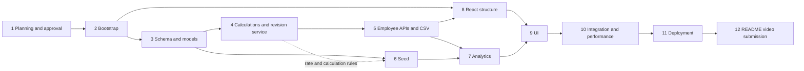

# Implementation Plan

**Precedence:** rank 6 in the hierarchy defined in `architecture-review.md` §1. It sequences work; it does not define business rules or API behaviour.
**Status:** Proposed. **Implementation must not start** until the owner explicitly approves the documentation (gate G0). No estimates, durations or performance targets appear here: the assessment specifies none and nothing has been measured.

Decisions are tracked **only** in the register (`architecture-review.md` §3). Each phase below lists the decisions it is blocked by; a phase must not begin while any blocking decision is still `[APPROVAL]`. The "Blocked by" lists follow the "Blocks" lines of the register and are cumulative with earlier gates (G1 → G2 → G3 …); where they differ, the register wins and this plan must be corrected.

General rules for every phase: follow `.github/copilot-instructions.md`; check the register before implementing; small incremental commits; do not commit or push without explicit owner permission; do not claim a check passed unless it was run; stop and ask when a blocking decision is open.

## Approval gates

| Gate | Blocks | Decisions that must be approved |
|------|--------|---------------------------------|
| **G0** | Phase 2 | Owner's explicit approval of the six documents and the register; DR-24 (baseline dependencies) |
| **G1** | Phase 3 | DR-01, DR-03, DR-05, DR-09, DR-11, DR-12, DR-14, DR-20 (database provider chosen and `btree_gist` verified, or weaker fallback explicitly approved), DR-21 (decided from the Phase 2 spike) |
| **G2** | Phase 4 | DR-04, DR-06, DR-07, DR-10 (and G1) |
| **G3** | Phase 5 | DR-02, DR-18, DR-19, DR-23 (write-endpoint rate-limiting decision) (and G2) |
| **G4** | Phases 6, 7 | Phase 6: DR-17 (and DR-07 from G2). Phase 7: DR-08, DR-13, DR-15, DR-16 |
| **G5** | Phase 11 | DR-22 (hosting, topology and CORS handling, including whether `rack-cors` may be added) |

Gate status: **no gate has been passed.** Nothing in this repository is evidence of owner approval; a gate is passed only when the owner explicitly approves its decisions and the register is updated.

Every blocker in the register appears in a gate: DR-01 (G1), DR-02 (G3), DR-03 (G1), DR-04 (G2). Phase 1 ends only when G0 is passed **and** the G1 items are either approved or explicitly scheduled for resolution during Phase 2 (DR-20 verification and DR-21 spike) before Phase 3 starts.

## Dependency overview and critical path

**Critical path:** 1 → 2 → 3 → 4 → 5 → 7 → 9 → 10 → 11 → 12.
**Parallelisable:** Phase 6 (seed) alongside Phases 4–5 once Phase 3 is done; the Phase 8 skeleton can start after Phase 2 against the approved contract with fixtures (the live-API integration in Phase 8 needs Phase 5); README drafting and AI-artifact collection run throughout.

## Endpoint coverage

| Endpoint (`api-contracts.md`) | Built in | UI in |
|-------------------------------|----------|-------|
| `GET /employees` | Phase 5 | Phase 9 directory |
| `GET /employees/:id` | Phase 5 | Phase 9 detail |
| `POST /employees/:id/salary_revisions` | Phase 5 (service: Phase 4) | Phase 9 revision form |
| `GET /analytics/summary` | Phase 7 | Phase 9 dashboard |
| `GET /employees/export.csv` | Phase 5 | Phase 9 export link |
| `GET /reference_data` (DR-14) | Phase 5 | Phases 8–9 filters/forms |
| Framework health route (outside the contract) | Phase 2 | — |

---

## Phase 1 — Planning and architecture approval (current)

- **Goal:** an agreed, internally consistent design with every blocking decision resolved or explicitly scheduled.
- **Scope:** owner review of the six documents; resolve `[APPROVAL]` items in the register by gate; apply approved decisions to the documents; update the register statuses.
- **Prerequisites:** `docs/requirements.md`; the owner-held assessment source.
- **Deliverables:** `.github/copilot-instructions.md`, `docs/architecture.md`, `docs/domain-decisions.md`, `docs/api-contracts.md`, `docs/implementation-plan.md`, `docs/architecture-review.md`.
- **Acceptance:** gate G0 passed; G1 items approved or scheduled; no document describes a pending decision as approved.
- **Checks:** read-through for cross-document contradictions; Mermaid diagrams render; the consistency audit in `architecture-review.md` is repeated after owner changes.
- **Commit:** `docs: add architecture, domain decisions, API contracts and Copilot guidance` (only when the owner asks for a commit).
- **Resolves (does not wait on another phase):** gate G0 — DR-24 and the owner's explicit approval; the G1 items are approved here or scheduled per the note under the gate table.

## Phase 2 — Repository and application bootstrap (planned, not executed)

- **Goal:** empty-but-running Rails API and React app in one monorepo, plus a database capability spike.
- **Scope:** `.gitignore` (including `.DS_Store`); Rails API-only app in `backend/` (PostgreSQL, RSpec); Vite React-TS app in `frontend/` (Tailwind, Vitest + RTL, TanStack Query, router — exactly the DR-24 list); the framework health route; one trivial passing test per side; README stub with pinned versions chosen from what is current at that time. **Capability spike (not committed as product code):** on a throwaway local database, confirm (a) `btree_gist` can be enabled, (b) an exclusion constraint on a `tstzrange` plus CHECKs and a partial unique index are dumped and reloaded faithfully by the pinned Rails version, to settle DR-21. The owner verifies the chosen hosted PostgreSQL supports `btree_gist` (DR-20).
- **Prerequisites:** gate G0; local PostgreSQL.
- **Deliverables:** `backend/`, `frontend/`, `.gitignore`, README stub, lockfiles; a short written spike result recorded in the register (DR-20, DR-21).
- **Acceptance:** `rails server` boots; both test suites pass; SPA reaches the health route in development; no dependency outside DR-24; DR-20/DR-21 outcomes recorded.
- **Checks:** run both suites and report real output; list dependencies against DR-24.
- **Commits:** `chore: bootstrap Rails API`, `chore: bootstrap React app`, `docs: pin versions in README`.
- **Blocked by:** DR-24 (gate G0).
- **Risks:** version compatibility; schema dump fidelity; hosted database lacks `btree_gist` (then the owner chooses another provider or approves the weaker fallback **before** Phase 3).

## Phase 3 — Database schema, models, constraints, model specs

- **Goal:** the six tables with all constraints; models with validations.
- **Scope:** `btree_gist`; migrations for `countries`, `departments`, `currencies` (DR-14), `employees`, `salary_records` (CHECKs, partial unique index, exclusion constraint), `exchange_rates`; models, enums, associations; read-only discipline for past salary records; schema format per DR-21.
- **Prerequisites:** gate G1.
- **Deliverables:** migrations, schema file, models, minimal factories, model specs.
- **Acceptance:** the database rejects two open records, overlapping closed ranges, `effective_to <= effective_from`, non-positive amount/rate, bad status/frequency, `terminated_on` mismatch, unknown currency; boundary-touching `[a,b)` + `[b,c)` is accepted.
- **Checks:** specs against the real database for each constraint (no mocks); a spec showing the **partial unique index alone does not block a historical overlap** while the exclusion constraint does; the schema file reloads into an empty database.
- **Commits:** `feat(db): add schema with salary interval constraints`, `test: model and constraint specs`.
- **Blocked by:** DR-01, DR-03, DR-05, DR-09, DR-11, DR-12, DR-14, DR-20, DR-21.

## Phase 4 — Salary calculations and revision service

- **Goal:** money rules and the revision workflow, fully tested, no HTTP.
- **Scope:** annualization, conversion and rounding in Ruby (`BigDecimal`) and the one SQL fragment; amount parsing per `domain-decisions.md` §4.3; rate lookup per §3.3; `SalaryRevisions::Create` implementing `domain-decisions.md` §7 in its exact order: lock employee → read current record after the lock → token check (DR-04) → eligibility → validate request data and no-op → **one** clock read, truncated once → FX lookup by that timestamp's UTC date → reject if not later than the current `effective_from` → close previous → insert new → commit; injectable clock.
- **Prerequisites:** gate G2.
- **Deliverables:** calculation module, SQL fragment module, parser/validator, service, specs.
- **Acceptance:** worked examples in `domain-decisions.md` §4.2 pass exactly; **SQL and Ruby agree on a shared fixture set (parity tests)**; previous `effective_to` equals new `effective_from` exactly (no offset); the rate lookup date is the UTC date of the same timestamp; a clock double that raises on a second call proves a single read; a spec proves the current record is read only after the lock; every error path writes nothing; one spec per condition: stale token (`stale_salary_record`), each employment status (`active`/`on_leave` succeed, `terminated` → `employee_not_eligible`, subject to DR-03), `no_change`, `missing_exchange_rate`, `revision_conflict`, and invalid-amount cases (valid/invalid syntax table, scientific notation, >2 decimals, zero, over bound, over capacity); JSON-number amounts are rejected at the controller layer (Phase 5).
- **Checks:** concurrency spec with two connections revising the same employee: one succeeds, the other gets a stale-token or serialized result, history stays valid (transactional tests off for that spec; deterministic, not time-based).
- **Commits:** `feat: salary calculations`, `feat: salary revision service`.
- **Blocked by:** DR-01, DR-03, DR-04, DR-05, DR-06, DR-07, DR-09, DR-10, DR-11, DR-12.
- **Risks:** SQL/Ruby formula drift; microsecond truncation; transactional-test interaction with locks.

## Phase 5 — Employee APIs, pagination, filters, CSV export

- **Goal:** implement the **exact** approved contracts for endpoints 1, 2, 3, 5 and 6 of `api-contracts.md`.
- **Scope:** routes (export before `:id`); `Employees::Directory` (shared by list and export); serializers; error mapping for every code in the contract table; write-key check per `architecture.md` §9.3 (`403` before `401`, constant-time compare, fail closed, never log the header); CSV streaming; reference data with the `has_rate` definition.
- **Prerequisites:** gate G3 (read endpoints may start after Phase 3).
- **Deliverables:** controllers, query object, serializers, request specs.
- **Acceptance:** every response matches the contract examples; strict parameter validation; stable pagination; `page` malformed/zero/negative → 400, page beyond last → 200 with empty `data`, empty result → `total_pages: 0`; export applies the same filters **and sort/direction** as the directory, ignores paging and includes all matching rows; list and export share the filter code; money is always strings; JSON-number `amount` → 400; each error code in the contract table reachable and tested in the documented precedence order (including `403` before `401` when no key is configured, and `internal_error` returning a generic body with no exception text); history returned newest first.
- **Checks:** request specs per status code; query-count specs for list and detail (no N+1); **CSV spec covering every case in the sanitization table of `api-contracts.md` §5** (direct `= + - @`, whitespace-preceded, leading TAB/CR/LF, embedded commas/quotes/newlines, ordinary negative numeric values left intact, text `-100.00` prefixed) plus empty result and sort order; SQL-injection attempts in `q` and `sort`; spec that the write key never appears in logs or responses.
- **Commits:** `feat(api): employee directory`, `feat(api): employee detail`, `feat(api): salary revision endpoint`, `feat(api): CSV export`, `feat(api): reference data`.
- **Blocked by:** DR-01, DR-02, DR-03, DR-04, DR-05, DR-11, DR-14, DR-18, DR-19, DR-23. (The reference-data `low_sample_threshold` field waits for DR-08 and is added in Phase 7.)

## Phase 6 — Deterministic 10,000-employee seed

- **Goal:** repeatable synthetic dataset exactly as specified.
- **Scope:** `Seeds::DemoDataset` with fixed RNG seed and anchor date; curated name lists; reference data, rates, employees, historical + open salary records via batched bulk insert; production guard; post-seed verification; a small-N mode for tests.
- **Prerequisites:** Phase 3, gate G1, DR-07 (from G2) and gate G4 (DR-17). Phase 6 does not need Phases 4–5 but must reuse the rate-lookup and calculation rules (Phase 4 deliverables) for seeded `fx_rate` and verification, so verification that needs them runs after Phase 4.
- **Deliverables:** seed code, data files, specs, documented command.
- **Acceptance:** exactly 10,000 employees; every employee has exactly one open record; no overlaps; `terminated_on` rules; every record has `fx_rate`; coverage per `domain-decisions.md` §11 including a below-threshold group and countries sharing a currency; `status_counts` sum to 10,000; two consecutive runs produce identical data fingerprints.
- **Checks:** run the seed, run the verification queries, compare a stable fingerprint across two runs. Report runtime only as a measured fact.
- **Commit:** `feat: deterministic demo seed`.
- **Blocked by:** DR-03, DR-05, DR-07, DR-17.
- **Risks:** bulk insert bypasses model validations (DB constraints and verification cover the gap); realism creep.

## Phase 7 — Compensation analytics and query tests

- **Goal:** endpoint 4 using **exact numeric analytics**.
- **Scope:** `Analytics::Summary`: totals/average over rounded per-employee values; **exact numeric median** via `ROW_NUMBER()` ranking and group counts (`domain-decisions.md` §10.3) with no `percentile_cont` and no `double precision` cast; filters; `low_sample`; `local_totals`; `status_counts` semantics; empty-group contract; add `low_sample_threshold` to reference data once DR-08 is approved.
- **Prerequisites:** Phases 5 and 6 (or fixtures); gate G4.
- **Deliverables:** query object, controller, serializer, specs.
- **Acceptance:** active-only metrics; no raw cross-currency sums; totals equal the sum of rounded employee rows; median specs for odd, even, even-with-half-cent, even-with-duplicates, single-row, large-magnitude and empty cases at organization, country and department level; `status_counts` sums to 10,000 unfiltered and to the filtered population when filtered; empty result returns `"0.00"`/`null` and omits empty groups; no `NaN`.
- **Checks:** hand-computed small fixtures (mixed currency/frequency); dashboard total equals the CSV `annual_base_usd` sum for `status=active`; a spec that fails if the median uses `percentile_cont` or a float cast; a check on the pinned PostgreSQL version of the coercion behaviour described in `domain-decisions.md` §10.3.
- **Commit:** `feat(api): compensation analytics`.
- **Blocked by:** DR-03, DR-06, DR-08, DR-13, DR-15, DR-16.

## Phase 8 — React application structure and API integration

- **Goal:** SPA skeleton and typed API layer; no feature UI.
- **Scope:** routes, layout, API client with error mapping for every contract code, TanStack Query hooks, types mirroring the contracts, a money **display-only** formatter, in-memory write-passphrase state (React state only; lost on page reload or tab close, **not** cleared by client-side route changes, discarded on `401`; never in `localStorage`/`sessionStorage`/cookies/URLs/`VITE_*`).
- **Prerequisites:** Phase 2; the approved contract (fixtures allowed before the backend is ready; live integration after Phase 5); DR-22 should be known because it fixes the API base URL and CORS needs.
- **Deliverables:** `frontend/src` structure, client/formatter tests.
- **Acceptance:** hooks fetch from a running backend; typed errors surface; **no money arithmetic, comparison or aggregation in TypeScript** (money values stay strings; only formatting); passphrase handling as specified.
- **Checks:** `vitest run`, type-check, lint if configured; a test that amounts remain strings end-to-end.
- **Commit:** `feat(ui): app shell and API client`.
- **Blocked by:** DR-02, DR-14, DR-18. (DR-22 should be known before this phase because it fixes the API base URL and CORS needs, but is a hard gate only at Phase 11.)

## Phase 9 — Dashboard, directory, employee detail and revision UI

- **Goal:** the four user workflows matching the approved API and eligibility rules.
- **Scope:** directory (search/filters/sort/pagination in URL; export link carries filters, **sort and direction**, not paging); detail with history (newest first); revision form with eligibility from `can_revise_salary` (under the DR-03 working default `on_leave` allowed, `terminated` not; follows whatever DR-03 finally approves) and handling of **401, 403, 409 (`stale_salary_record` and `revision_conflict`), 422 (`employee_not_eligible`, `validation_failed`, `no_change`, `missing_exchange_rate`)** as in `architecture.md` §9.3, plus generic 400/500; cache invalidation after success; dashboard showing group sizes, low-sample flag, empty-state, caveat copy.
- **Prerequisites:** Phases 7 and 8.
- **Deliverables:** components, pages, tests.
- **Acceptance:** each workflow works end-to-end in a browser; low-sample groups visibly flagged; caveat text present; terminated employees show no revise action while on-leave employees do; no wording implying pay inequity, attrition or compa-ratio; export-button note on reconciliation with the dashboard.
- **Checks:** RTL tests for filters→URL→request, export link params, revision errors per code, passphrase clearing on 401, hidden form on 403, stale-token reload; a real manual browser pass.
- **Commits:** one per page/workflow.
- **Blocked by:** DR-01, DR-02, DR-03, DR-04, DR-08, DR-14, DR-16, DR-18.
- **Risks:** UI scope creep (charts need approval).

## Phase 10 — Integration, regression and performance verification

- **Goal:** confidence on the full 10,000-row dataset with **actual measurements**.
- **Scope:** end-to-end happy paths on the seeded database; regression pass over all invariants (`domain-decisions.md` §13); measure list, filter, search, analytics and export on 10,000 rows (`EXPLAIN ANALYZE`, timings recorded with machine and configuration); measure the detail endpoint with a long-history fixture (DR-19); add an index only if a measurement justifies it; frontend types vs contracts cross-check.
- **Prerequisites:** Phases 6–9.
- **Deliverables:** minimal integration checks; a README "performance" section containing only measured numbers; any justified index.
- **Acceptance:** all suites green; no N+1; invariants hold after exercising revisions on seeded data; every number reported is a measurement with its context, never an estimate. The assessment sets no performance target, so none is asserted.
- **Commits:** `test: integration checks`; `perf: <index>` only if measured.
- **Risks:** slow `ILIKE` search (fallback `pg_trgm` needs approval); slow exact median (optimize the query before considering any cache).

## Phase 11 — Deployment and production demo-data verification

- **Goal:** the approved design deployed and working.
- **Scope:** hosting per DR-22; database with `btree_gist` (verified before Phase 3); environment secrets; HTTPS; CORS or same-origin; migrations and one seed run; verification.
- **Prerequisites:** Phase 10; gate G5.
- **Deliverables:** deployment configuration (first created here), runbook, production smoke checklist.
- **Acceptance:** exactly 10,000 employees in production; invariant queries pass; revision succeeds with the key and is refused with `401` without or with a wrong key; with the key unset a non-production verification instance returns `403 writes_disabled`; CSV downloads with filters and sort; CORS (if cross-origin) allows only the configured origins and never a wildcard; no secret in the repository, the built bundle or logs (including the `Authorization` header); writes only over HTTPS; `500` responses carry no internal details; throttling in place only if DR-23 approved it.
- **Checks:** run verification queries against production; inspect the bundle and logs; attempt an unauthenticated and a wrong-key `POST`; request from a non-allow-listed origin.
- **Commits:** `chore: deployment configuration`, `docs: deployment runbook`.
- **Blocked by:** DR-02, DR-22 (and DR-23 if throttling was approved).
- **Risks:** provider limits, cold starts, export timeouts, seed run limits — unknown until a provider is chosen.

## Phase 12 — README, AI artifacts, video demo and final email submission

- **Goal:** a complete submission that satisfies the **actual assessment requirements**.
- **Scope:** README (overview, run instructions, architecture diagram, trade-offs, measured performance, **documented AI-assisted work**: how AI was used, prompts and instructions); committed design/AI artifacts (`docs/`, `.github/prompts/`, `.github/copilot-instructions.md`); the one-page requirements document (`docs/requirements.md`); a screen-recorded **video demonstration** of the deployed software; confirm the **deployed** application is functional; commit all code to the Git repository with incremental history; **reply to the same email with the repository link**.
- **Prerequisites:** Phase 11.
- **Deliverables:** README, final doc touch-ups, demo video, reply email text.
- **Acceptance:** a stranger can run the project from the README; README claims match measured facts; the write passphrase is delivered privately and never committed; commit history is incremental; the assessment PDF is **not** added to a public repository unless the owner explicitly approves; items the assessment leaves unspecified (deadline, hosting provider, video duration) are not claimed.
- **Checks:** clean-clone run-through of the README; link check; confirm the email reply contains the repository link.
- **Commit:** `docs: README and submission artifacts`.

---

## Cross-cutting checks (each phase)
- Relevant test suites pass and were actually run; reported output is real.
- No dependency or infrastructure beyond what the phase lists and the register approves.
- Documents updated when a decision changes, with the register as the single place for decision status.
- Each commit builds and its tests pass; no commit or push without explicit owner permission.
